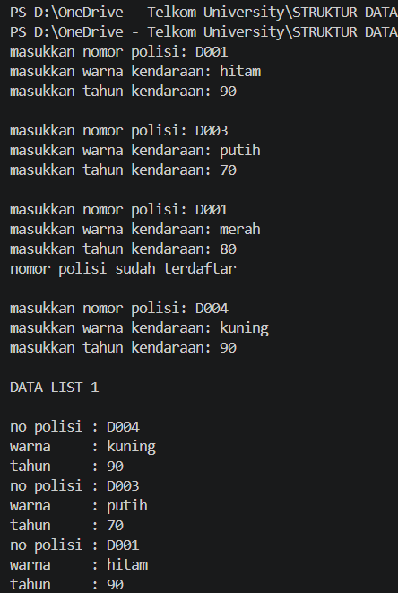
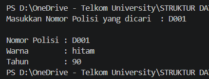
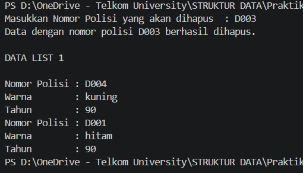

# <h1 align="center">Laporan Praktikum Modul 6 - Doubly Linked List  (Bagian Pertama)</h1>
<p align="center">Ghaly Firasah Pasha - 109082500147</p>

## Dasar Teori
Linked list atau senarai berantai adalah struktur data linier dinamis yang tersusun atas rangkaian simpul (node) yang saling terhubung melalui pointer di dalam memori [1]. Pada Doubly Linked List (senarai berantai ganda), setiap simpul dirancang memiliki dua buah penunjuk (pointer), yaitu pointer yang mengacu pada simpul sebelumnya (prev) dan pointer yang mengacu pada simpul sesudahnya (next) [2]. Keberadaan dua pointer ini membedakan Doubly Linked List secara signifikan dari Singly Linked List, karena memungkinkan proses penelusuran data dilakukan secara fleksibel ke dua arah, baik maju (forward) maupun mundur (backward) [3]. Selain itu, struktur senarai ini umumnya dilengkapi dengan dua penunjuk utama pada list, yakni pointer first yang menunjuk simpul pertama dan last yang menunjuk simpul terakhir, sehingga operasi pada kedua ujung senarai dapat dieksekusi secara langsung dan efisien [4].

### A. Konsep Dasar, Representasi Struktur Data, dan Karakteristik Doubly Linked List<br/>
Representasi fisik Doubly Linked List menggunakan pointer ganda memberikan keleluasaan dalam mengelola urutan data secara dinamis tanpa batasan kapasitas tetap seperti pada struktur data larik (array) [3].

#### 1. Struktur Simpul (Node) dan Karakteristik Dua Pointer (next dan prev)
Setiap simpul (elmlist) pada Doubly Linked List direpresentasikan sebagai sebuah tipe data bentukan (struct) yang memuat tiga komponen utama, yaitu medan informasi (info) bertipe infotype untuk menyimpan data (baik data tunggal maupun data majemuk/rekod), medan tautan penerus (next) bertipe address yang menunjuk alamat simpul berikutnya, dan medan tautan pendahulu (prev) bertipe address yang menunjuk alamat simpul sebelumnya [1]. Pada senarai linier non-sirkular, simpul paling awal memiliki prev yang bernilai Nil (NULL) sebagai penanda batas awal, sedangkan simpul paling akhir memiliki next yang juga bernilai Nil sebagai penanda batas akhir senarai [4]. Melalui operator penunjuk panah (->), program dapat mengakses nilai dan mengarahkan sambungan antar-simpul menggunakan notasi P->info, P->next, maupun P->prev [2].

#### 2. Representasi Senarai dengan Penunjuk Awal (first) dan Akhir (last)
Dalam ADT Doubly Linked List, senarai itu sendiri diwadahi dalam struktur list yang memegang dua variabel alamat utama, yaitu first dan last [5]. Pada saat senarai baru dibentuk melalui prosedur CreateList(L), kedua penunjuk tersebut diinisialisasi dengan nilai Nil (L.first = Nil dan L.last = Nil) yang menandakan bahwa senarai berada dalam kondisi kosong. Keberadaan pointer last sangat menguntungkan karena penambahan maupun penghapusan elemen di ujung akhir list tidak lagi memerlukan penelusuran sekuensial dari awal seperti pada Singly Linked List, melainkan dapat diakses seketika dalam kompleksitas waktu O(1) [3].

#### 3. Keunggulan Penelusuran Dua Arah (Bidirectional Traversal) dan Manajemen Memori
Keunggulan utama dari Doubly Linked List adalah dukungannya terhadap penelusuran dua arah (bidirectional traversal), yang memungkinkan program bergerak maju dari first ke last menggunakan pointer next atau bergerak mundur dari last ke first menggunakan pointer prev [4]. Manajemen memori pada struktur ini diterapkan secara dinamis melalui fungsi alokasi(X) yang memesan memori baru dengan operator new, mengisi medan informasi dengan X, serta mengeset kedua pointer simpul tersebut ke Nil. Sebaliknya, saat simpul dilepaskan dari senarai, memori harus dibebaskan kembali ke sistem operasi melalui prosedur dealokasi(P) dengan perintah delete P guna mencegah terjadinya kebocoran memori (memory leak) [2].

### B. Operasi Primitif Penyisipan (Insertion) dan Penghapusan (Deletion) pada Doubly Linked List<br/>
Operasi manipulasi elemen pada Doubly Linked List memerlukan ketelitian dalam menyambungkan maupun memutuskan relasi pointer dua arah agar integritas rantai senarai tetap terjaga [5].

#### 1. Operasi Penyisipan Elemen (insertFirst, insertLast, insertAfter, dan insertBefore)
Penambahan simpul baru P yang telah dialokasikan ke dalam senarai dapat dilakukan pada berbagai posisi [1]:
* **Penyisipan Awal (insertFirst)**: Menyambungkan P->next ke L.first, mengarahkan (L.first)->prev ke P, dan memperbarui L.first = P. Jika list awalnya kosong, L.last juga diarahkan ke P.
* **Penyisipan Akhir (insertLast)**: Menyambungkan P->prev ke L.last, mengarahkan (L.last)->next ke P, dan memperbarui L.last = P.
* **Penyisipan Tengah (insertAfter dan insertBefore)**: Pada operasi insertAfter(L, P, Prec), simpul P disisipkan sesudah simpul Prec dengan mengatur empat penunjuk memori, yaitu P->next = Prec->next, P->prev = Prec, (Prec->next)->prev = P, dan Prec->next = P. Operasi insertBefore(L, P, Succ) bekerja dengan logika simetris untuk menempatkan simpul sebelum simpul Succ [3].

#### 2. Operasi Penghapusan Elemen (deleteFirst, deleteLast, deleteAfter, dan deleteBefore)
Pelepasan elemen dari senarai dilakukan dengan memutus keterkaitan dua arah dan memperbarui penunjuk senarai [5]:
* **Penghapusan Awal (deleteFirst)**: Mengisolasi simpul pertama P = L.first, memajukan L.first ke (L.first)->next, mengeset (L.first)->prev = Nil, serta memutuskan P->next = Nil dan P->prev = Nil sebelum didealokasi.
* **Penghapusan Akhir (deleteLast)**: Mengisolasi simpul terakhir P = L.last, memundurkan L.last ke (L.last)->prev, mengeset (L.last)->next = Nil, serta mengisolasi kedua pointer pada P.
* **Penghapusan Tengah (deleteAfter dan deleteBefore)**: Operasi deleteAfter(Prec, P) melepas simpul P = Prec->next dengan menghubungkan kembali Prec->next langsung ke simpul di depan P (P->next) dan memperbarui penunjuk balik prev-nya, sedangkan deleteBefore bekerja sebaliknya dengan melepas simpul di belakang simpul acuan [1].

#### 3. Operasi Penelusuran (View), Pencarian (Searching), dan Pembaruan Data (Update)
Selain penyisipan dan penghapusan, ADT Doubly Linked List menyediakan operasi penelusuran (printInfo) yang mencetak seluruh data simpul dari awal hingga akhir senarai [2]. Operasi pencarian (findElm(L, X)) dilakukan dengan menelusuri simpul demi simpul untuk mencocokkan nilai atribut tertentu (misalnya nomor polisi pada data kendaraan) dan mengembalikan alamat simpul yang bersangkutan jika ditemukan. Setelah simpul berhasil ditemukan melalui operasi searching, pembaruan isi data simpul (update) dapat dieksekusi secara instan tanpa perlu memutus tautan rantai pointer [5].

## Guided 

### 1. Doublylist

```C++
//header
#ifndef DOUBLYLIST_H
#define DOUBLYLIST_H
#include <string>
using namespace std;

struct barang {
    string kode;
    string nama;
    int tahun;
};

using infotype = barang;
struct elmlist;
using address = elmlist*;
struct elmlist { infotype info; address prev; address next; };
struct list { address first; address last; };

void CreateList(list &L);
address alokasi(const infotype &x);
void dealokasi(address &P);
void insertFirst(list &L, address P);
void insertLast(list &L, address P);
void insertAfter(list &L, address R, address P);
void insertBefore(list &L, address R, address P);
void printInfo(const list &L);
address findElm(const list &L, const string &kode);
void deleteFirst(list &L, address &P);
void deleteLast(list &L, address &P);
void deleteAfter(list &L, address Prec, address &P);
void deleteBefore(list &L, address succ, address &P);

#endif

//body
#include <iostream>
#include <iomanip>
#include "Doublylist.h"
using namespace std;

void CreateList(list &L) { L.first = nullptr; L.last = nullptr; }

address alokasi(const infotype &x) {
    address P = new elmlist;
    P->info = x;
    P->prev = nullptr; P->next = nullptr;
    return P;
}
void dealokasi(address &P) {
    if (P != nullptr) { delete P; P = nullptr; }
}
void insertFirst(list &L, address P) {
    if (!P) return;
    P->prev = nullptr; P->next = L.first;
    if (L.first) L.first->prev = P;
    else L.last = P;
    L.first = P;
}
void insertLast(list &L, address P) {
    if (!P) return;
    P->next = nullptr; P->prev = L.last;
    if (L.last) L.last->next = P;
    else L.first = P;
    L.last = P;
}

// Menyisipkan P tepat setelah R.
void insertAfter(list &L, address R, address P) {
    if (!R || !P) return;
    P->prev = R;
    P->next = R->next;
    if (R->next) R->next->prev = P;
    else L.last = P;
    R->next = P;
}

// Menyisipkan P tepat sebelum R.
void insertBefore(list &L, address R, address P) {
    if (!R || !P) return;
    P->next = R;
    P->prev = R->prev;
    if (R->prev) R->prev->next = P;
    else L.first = P;
    R->prev = P;
}
void printInfo(const list &L) {
    address P = L.first;
    if (!P) {
        cout << "List kosong.\n";
        return;
    }

    cout << "+-----------------------------+\n";
    cout << "| Kode   | Nama       | Tahun |\n";
    cout << "+-----------------------------+\n";
    while (P) {
        cout << "| " << left << setw(6) << P->info.kode
             << " | " << setw(10) << P->info.nama
             << " | " << setw(5) << P->info.tahun << " |\n";
        P = P->next;
    }
    cout << "+-----------------------------+\n";
}
address findElm(const list &L, const string &kode) {
    address P = L.first;
    while (P) {
        if (P->info.kode == kode) return P;
        P = P->next;
    }
    return nullptr;
}
void deleteFirst(list &L, address &P) {
    if (!L.first) { P = nullptr; return; }
    P = L.first; L.first = P->next;
    if (L.first) L.first->prev = nullptr;
    else L.last = nullptr;
    P->prev = P->next = nullptr;
}
void deleteLast(list &L, address &P) {
    if (!L.last) { P = nullptr; return; }
    P = L.last; L.last = P->prev;
    if (L.last) L.last->next = nullptr;
    else L.first = nullptr;
    P->prev = P->next = nullptr;
}
// Menghapus node tepat setelah prec.
void deleteAfter(list &L, address prec, address &P) {
    P = nullptr;
    if (!prec || !prec->next) return;
    P = prec->next; prec->next = P->next;
    if (P->next) P->next->prev = prec;
    else L.last = prec;
    P->prev = P->next = nullptr;
}
// Menghapus node tepat sebelum succ.
void deleteBefore(list &L, address succ, address &P) {
    P = nullptr;
    if (!succ || !succ->prev) return;
    P = succ->prev; succ->prev = P->prev;
    if (P->prev) P->prev->next = succ;
    else L.first = succ;
    P->prev = P->next = nullptr;
}

//main
#include <iostream>
#include "Doublylist.h"
using namespace std;

void tampilkanJudul(const string &judul) {
    cout << "\n====================================\n";
    cout << judul << '\n';
    cout << "====================================\n";
}

int main() {
    list L;
    CreateList(L);

    infotype barang1 = {"B001", "Laptop", 2020};
    infotype barang2 = {"B002", "Monitor", 2022};
    infotype barang3 = {"B003", "Keyboard", 2023};
    infotype barang4 = {"B004", "Mouse", 2024};

    address P = nullptr;
    address posisi = nullptr;

    cout << "DEMONSTRASI OPERASI DOUBLY LINKED LIST\n";
    cout << "Data yang digunakan: B001, B002, B003, dan B004\n";

    tampilkanJudul("[1] INSERT FIRST");
    cout << "Menambahkan B002 di awal list.\n";
    insertFirst(L, alokasi(barang2));
    printInfo(L);

    tampilkanJudul("[2] INSERT LAST");
    cout << "Menambahkan B004 di akhir list.\n";
    insertLast(L, alokasi(barang4));
    printInfo(L);

    tampilkanJudul("[3] INSERT AFTER");
    cout << "Menambahkan B003 setelah B002.\n";
    posisi = findElm(L, "B002");
    if (posisi != nullptr) {
        insertAfter(L, posisi, alokasi(barang3));
    }
    printInfo(L);

    tampilkanJudul("[4] INSERT BEFORE");
    cout << "Menambahkan B001 sebelum B002.\n";
    posisi = findElm(L, "B002");
    if (posisi != nullptr) {
        insertBefore(L, posisi, alokasi(barang1));
    }
    printInfo(L);

    tampilkanJudul("[5] FIND ELEMENT");
    cout << "Mencari barang dengan kode B003.\n";
    posisi = findElm(L, "B003");
    if (posisi != nullptr) {
        cout << "Data ditemukan:\n";
        cout << "  Kode   : " << posisi->info.kode << '\n';
        cout << "  Nama   : " << posisi->info.nama << '\n';
        cout << "  Tahun  : " << posisi->info.tahun << '\n';
    } else {
        cout << "Data tidak ditemukan.\n";
    }

    tampilkanJudul("[6] DELETE AFTER");
    cout << "Menghapus node setelah B002 (B003).\n";
    posisi = findElm(L, "B002");
    deleteAfter(L, posisi, P);
    if (P != nullptr) {
        cout << "Node yang dihapus: " << P->info.kode << '\n';
        dealokasi(P);
    } else {
        cout << "Tidak ada node yang dapat dihapus.\n";
    }
    printInfo(L);

    tampilkanJudul("[7] DELETE BEFORE");
    cout << "Menghapus node sebelum B004 (B002).\n";
    posisi = findElm(L, "B004");
    deleteBefore(L, posisi, P);
    if (P != nullptr) {
        cout << "Node yang dihapus: " << P->info.kode << '\n';
        dealokasi(P);
    } else {
        cout << "Tidak ada node yang dapat dihapus.\n";
    }
    printInfo(L);

    tampilkanJudul("[8] DELETE FIRST");
    cout << "Menghapus node pertama.\n";
    deleteFirst(L, P);
    if (P != nullptr) {
        cout << "Node yang dihapus: " << P->info.kode << '\n';
        dealokasi(P);
    } else {
        cout << "List kosong, tidak ada node yang dapat dihapus.\n";
    }
    printInfo(L);

    tampilkanJudul("[9] DELETE LAST");
    cout << "Menghapus node terakhir.\n";
    deleteLast(L, P);
    if (P != nullptr) {
        cout << "Node yang dihapus: " << P->info.kode << '\n';
        dealokasi(P);
    } else {
        cout << "List kosong, tidak ada node yang dapat dihapus.\n";
    }
    printInfo(L);

    tampilkanJudul("SELESAI");
    cout << "Kondisi list: "
         << (L.first == nullptr && L.last == nullptr ? "kosong.\n" : "masih berisi data.\n");

    return 0;
}

```
Program di atas mengimplementasikan Abstract Data Type (ADT) Doubly Linked List untuk mengelola rekod data barang (kode, nama, dan tahun) yang dipisahkan ke dalam file header (Doublylist.h) untuk deklarasi tipe serta prototipe fungsi, dan file body untuk realisasi algoritma menggunakan pointer ganda (prev dan next) serta penunjuk list first dan last. File implementasi menyediakan operasi manajemen memori dinamis (alokasi dan dealokasi), operasi penyisipan fleksibel (insertFirst, insertLast, insertAfter, dan insertBefore), pencarian simpul berdasarkan kode barang (findElm), pencetakan isi tabel (printInfo), serta penghapusan simpul di berbagai posisi (deleteFirst, deleteLast, deleteAfter, dan deleteBefore). Pada program utama (main.cpp), empat data barang (B001 hingga B004) diuji secara komprehensif mulai dari penyusunan urutan simpul dengan berbagai metode insert, pencarian data target, pelepasan simpul satu per satu menggunakan operasi delete, hingga memastikan seluruh simpul didealokasi dan list kembali dalam keadaan kosong.

## Unguided 

### 1. Buatlah ADT Doubly Linked list sebagai berikut di dalam file “Doublylist.h”. Buatlah implementasi ADT Doubly Linked list pada file “Doublylist.cpp” dan coba hasil implementasi ADT pada file “main.cpp”. 

```C++
//header
#ifndef DOUBLYLIST_H
#define DOUBLYLIST_H

#include <iostream>
#include <string>
#define Nil NULL

using namespace std;

struct kendaraan {
    string nopol;
    string warna;
    int thnBuat;
};

typedef kendaraan infotype;
typedef struct ElmList *address;

struct ElmList {
    infotype info;
    address next;
    address prev;
};

struct List {
    address First;
    address Last;
};

void CreateList(List &L);
address alokasi(infotype x);
void dealokasi(address &P);
void printInfo(List L);
void insertLast(List &L, address P);
bool cekNopol(List L, string nopol);

#endif

//body
#include "doublylist.h"

void CreateList(List &L) {
    L.First = Nil;
    L.Last = Nil;
}

address alokasi(infotype x) {
    address P = new ElmList;
    P->info = x;
    P->next = Nil;
    P->prev = Nil;
    return P;
}

void dealokasi(address &P) {
    delete P;
    P = Nil;
}

void insertLast(List &L, address P) {
    if (L.First == Nil) {
        L.First = P;
        L.Last = P;
    } else {
        P->prev = L.Last;
        (L.Last)->next = P;
        L.Last = P;
    }
}

bool cekNopol(List L, string nopol) {
    address P = L.First;
    while (P != Nil) {
        if (P->info.nopol == nopol) {
            return true;
        }
        P = P->next;
    }
    return false;
}

void printInfo(List L) {
    cout << "DATA LIST 1" << endl << endl;
    address P = L.Last;
    while (P != Nil) {
        cout << "no polisi : " << P->info.nopol << endl;
        cout << "warna     : " << P->info.warna << endl;
        cout << "tahun     : " << P->info.thnBuat << endl;
        P = P->prev;
    }
}

//main
#include "doublylist.h"

int main() {
    List L;
    CreateList(L);

    for (int i = 0; i < 4; i++) {
        infotype x;
        cout << "masukkan nomor polisi: ";
        cin >> x.nopol;
        cout << "masukkan warna kendaraan: ";
        cin >> x.warna;
        cout << "masukkan tahun kendaraan: ";
        cin >> x.thnBuat;

        if (cekNopol(L, x.nopol)) {
            cout << "nomor polisi sudah terdaftar" << endl;
        } else {
            address P = alokasi(x);
            insertLast(L, P);
        }
        cout << endl;
    }

    printInfo(L);

    return 0;
}
```
### Output Unguided 1 :

##### Output 


Program di atas mengimplementasikan Abstract Data Type (ADT) Doubly Linked List untuk menyimpan data kendaraan (nopol, warna, dan thnBuat) yang dibagi ke dalam tiga file, yaitu doublylist.h sebagai header, doublylist.cpp sebagai body implementasi, dan main_doubly.cpp sebagai program utama. File implementasi menyediakan operasi inisialisasi list kosong (CreateList), manajemen memori dinamis (alokasi dan dealokasi), penyisipan simpul di akhir senarai (insertLast), pengecekan duplikasi nomor polisi (cekNopol), serta pencetakan isi list secara mundur dari L.Last menggunakan pointer prev (printInfo). Pada fungsi main(), program menerima empat masukan data kendaraan secara berurutan, menolak nomor polisi D001 yang dimasukkan ulang karena sudah terdaftar, dan menampilkan ketiga data kendaraan yang valid (D004, D003, dan D001) ke layar.

### 2. Carilah elemen dengan nomor polisi D001 dengan membuat fungsi baru. fungsi findElm( L : List, x : infotype ) : address

```C++
//header
#ifndef DOUBLYLIST2_H
#define DOUBLYLIST2_H

#include <iostream>
#include <string>
#define Nil NULL

using namespace std;

struct kendaraan {
    string nopol;
    string warna;
    int thnBuat;
};

typedef kendaraan infotype;
typedef struct ElmList *address;

struct ElmList {
    infotype info;
    address next;
    address prev;
};

struct List {
    address First;
    address Last;
};

void CreateList(List &L);
address alokasi(infotype x);
void dealokasi(address &P);
void printInfo(List L);
void insertLast(List &L, address P);
address findElm(List L, infotype x);

#endif

//body
#include "doublylist2.h"

void CreateList(List &L) {
    L.First = Nil;
    L.Last = Nil;
}

address alokasi(infotype x) {
    address P = new ElmList;
    P->info = x;
    P->next = Nil;
    P->prev = Nil;
    return P;
}

void dealokasi(address &P) {
    delete P;
    P = Nil;
}

void insertLast(List &L, address P) {
    if (L.First == Nil) {
        L.First = P;
        L.Last = P;
    } else {
        P->prev = L.Last;
        (L.Last)->next = P;
        L.Last = P;
    }
}

address findElm(List L, infotype x) {
    address P = L.First;
    while (P != Nil) {
        if (P->info.nopol == x.nopol) {
            return P;
        }
        P = P->next;
    }
    return Nil;
}

void printInfo(List L) {
    cout << "DATA LIST 1" << endl << endl;
    address P = L.Last;
    while (P != Nil) {
        cout << "no polisi : " << P->info.nopol << endl;
        cout << "warna     : " << P->info.warna << endl;
        cout << "tahun     : " << P->info.thnBuat << endl;
        P = P->prev;
    }
}

//main
#include "doublylist2.h"

int main() {
    List L;
    CreateList(L);

    infotype k1 = {"D001", "hitam", 90};
    infotype k2 = {"D003", "putih", 70};
    infotype k3 = {"D004", "kuning", 90};

    insertLast(L, alokasi(k1));
    insertLast(L, alokasi(k2));
    insertLast(L, alokasi(k3));

    infotype cari;
    cout << "Masukkan Nomor Polisi yang dicari  : ";
    cin >> cari.nopol;
    cout << endl;

    address PFound = findElm(L, cari);
    if (PFound != Nil) {
        cout << "Nomor Polisi : " << PFound->info.nopol << endl;
        cout << "Warna        : " << PFound->info.warna << endl;
        cout << "Tahun        : " << PFound->info.thnBuat << endl;
    } else {
        cout << "Nomor Polisi " << cari.nopol << " tidak ditemukan." << endl;
    }

    return 0;
}
```
### Output Unguided 2 :

##### Output 


Program di atas menambahkan fitur pencarian data kendaraan pada ADT Doubly Linked List yang dipisahkan ke dalam tiga file, yaitu doublylist2.h sebagai header, doublylist2.cpp sebagai body implementasi, dan main_doubly2.cpp sebagai program utama. Fungsi findElm(List L, infotype x) pada file implementasi bekerja dengan menelusuri simpul secara sekuensial mulai dari L.First hingga Nil untuk memeriksa apakah atribut nomor polisi (P->info.nopol) sama dengan nomor polisi yang dicari (x.nopol), lalu mengembalikan alamat memori simpul tersebut jika cocok. Pada fungsi main(), setelah data kendaraan (D001, D003, dan D004) dimasukkan ke dalam senarai, program meminta masukan nomor polisi D001 dari pengguna, memanggil findElm(L, cari), dan menampilkan rincian nomor polisi, warna (hitam), serta tahun pembuatan (90) dari kendaraan yang ditemukan.

### 3. Hapus elemen dengan nomor polisi D003 dengan procedure delete. procedure deleteFirst( input/output L : List, P : address ). procedure deleteLast( input/output L : List, P : address ). procedure deleteAfter( input Prec : address, input/output P : address )

```C++
//header
#ifndef DOUBLYLIST3_H
#define DOUBLYLIST3_H

#include <iostream>
#include <string>
#define Nil NULL

using namespace std;

struct kendaraan {
    string nopol;
    string warna;
    int thnBuat;
};

typedef kendaraan infotype;
typedef struct ElmList *address;

struct ElmList {
    infotype info;
    address next;
    address prev;
};

struct List {
    address First;
    address Last;
};

void CreateList(List &L);
address alokasi(infotype x);
void dealokasi(address &P);
void printInfo(List L);
void insertLast(List &L, address P);
address findElm(List L, infotype x);
void deleteFirst(List &L, address &P);
void deleteLast(List &L, address &P);
void deleteAfter(address Prec, address &P);

#endif

//body
#include "doublylist3.h"

void CreateList(List &L) {
    L.First = Nil;
    L.Last = Nil;
}

address alokasi(infotype x) {
    address P = new ElmList;
    P->info = x;
    P->next = Nil;
    P->prev = Nil;
    return P;
}

void dealokasi(address &P) {
    delete P;
    P = Nil;
}

void insertLast(List &L, address P) {
    if (L.First == Nil) {
        L.First = P;
        L.Last = P;
    } else {
        P->prev = L.Last;
        (L.Last)->next = P;
        L.Last = P;
    }
}

address findElm(List L, infotype x) {
    address P = L.First;
    while (P != Nil) {
        if (P->info.nopol == x.nopol) {
            return P;
        }
        P = P->next;
    }
    return Nil;
}

void deleteFirst(List &L, address &P) {
    if (L.First != Nil) {
        P = L.First;
        if (L.First == L.Last) {
            L.First = Nil;
            L.Last = Nil;
        } else {
            L.First = (L.First)->next;
            (L.First)->prev = Nil;
            P->next = Nil;
        }
    }
}

void deleteLast(List &L, address &P) {
    if (L.Last != Nil) {
        P = L.Last;
        if (L.First == L.Last) {
            L.First = Nil;
            L.Last = Nil;
        } else {
            L.Last = (L.Last)->prev;
            (L.Last)->next = Nil;
            P->prev = Nil;
        }
    }
}

void deleteAfter(address Prec, address &P) {
    if (Prec != Nil && Prec->next != Nil) {
        P = Prec->next;
        Prec->next = P->next;
        if (P->next != Nil) {
            (P->next)->prev = Prec;
        }
        P->prev = Nil;
        P->next = Nil;
    }
}

void printInfo(List L) {
    cout << "DATA LIST 1" << endl << endl;
    address P = L.Last;
    while (P != Nil) {
        cout << "Nomor Polisi : " << P->info.nopol << endl;
        cout << "Warna        : " << P->info.warna << endl;
        cout << "Tahun        : " << P->info.thnBuat << endl;
        P = P->prev;
    }
}

//main
#include "doublylist3.h"

int main() {
    List L;
    CreateList(L);

    infotype k1 = {"D001", "hitam", 90};
    infotype k2 = {"D003", "putih", 70};
    infotype k3 = {"D004", "kuning", 90};

    insertLast(L, alokasi(k1));
    insertLast(L, alokasi(k2));
    insertLast(L, alokasi(k3));

    infotype hapus;
    cout << "Masukkan Nomor Polisi yang akan dihapus  : ";
    cin >> hapus.nopol;

    address PTarget = findElm(L, hapus);
    if (PTarget != Nil) {
        address P = Nil;
        if (PTarget == L.First) {
            deleteFirst(L, P);
        } else if (PTarget == L.Last) {
            deleteLast(L, P);
        } else {
            deleteAfter(PTarget->prev, P);
        }
        dealokasi(P);
        cout << "Data dengan nomor polisi " << hapus.nopol << " berhasil dihapus." << endl << endl;
    } else {
        cout << "Data dengan nomor polisi " << hapus.nopol << " tidak ditemukan." << endl << endl;
    }

    printInfo(L);

    return 0;
}
```
### Output Unguided 3 :

##### Output 


Program di atas menambahkan operasi penghapusan elemen pada ADT Doubly Linked List yang dipisahkan ke dalam tiga file, yaitu doublylist3.h sebagai header, doublylist3.cpp sebagai body implementasi, dan main_doubly3.cpp sebagai program utama. File implementasi menyediakan tiga prosedur penghapusan berdasarkan posisi simpul, yakni deleteFirst untuk melepas elemen pertama, deleteLast untuk melepas elemen terakhir, serta deleteAfter untuk melepas simpul tepat sesudah simpul Prec dengan menyambungkan kembali pointer next dan prev antar-simpul tetangganya. Pada fungsi main(), setelah pengguna memasukkan nomor polisi D003 dan alamatnya ditemukan menggunakan findElm, program menghapus simpul tersebut melalui prosedur deleteAfter(PTarget->prev, P) disertai dealokasi(P), kemudian menampilkan sisa data kendaraan pada DATA LIST 1 (D004 dan D001).

## Kesimpulan
Berdasarkan praktikum mengenai Doubly Linked List, dapat disimpulkan bahwa senarai berantai ganda merupakan struktur data dinamis yang setiap simpulnya memiliki dua penunjuk arah, yaitu prev untuk mengacu ke simpul sebelumnya dan next untuk mengacu ke simpul sesudahnya, serta dilengkapi penunjuk First dan Last pada struktur list. Penerapan konsep Abstract Data Type (ADT) yang memisahkan deklarasi tipe dan prototipe pada file header (*.h), realisasi algoritma pada file body (*.cpp), serta pengujian pada file main.cpp membuat pengelolaan data majemuk seperti data kendaraan menjadi lebih modular dan terstruktur. Keberadaan dua pointer pada setiap simpul serta penunjuk Last mempermudah proses penelusuran dua arah (forward maupun backward) dan memungkinkan operasi penyisipan (insertFirst, insertLast, insertAfter, insertBefore) dilakukan secara efisien tanpa harus selalu menelusuri senarai dari awal. Selain itu, perpaduan antara operasi pencarian (findElm) dan penghapusan simpul (deleteFirst, deleteLast, dan deleteAfter) yang diikuti dengan dealokasi terbukti mampu memutus keterkaitan pointer dua arah secara tepat sekaligus menjaga penggunaan memori tetap optimal.

## Referensi
[1] Triase. (2020). Diktat Edisi Revisi : STRUKTUR DATA. Medan: UNIVERSITAS ISLAM NEGERI SUMATERA UTARA MEDAN. 
<br>[2] Indahyati, Uce., Rahmawati Yunianita. (2020). "BUKU AJAR ALGORITMA DAN PEMROGRAMAN DALAM BAHASA C++". Sidoarjo: Umsida Press. Diakses pada 10 Maret 2024 melalui https://doi.org/10.21070/2020/978-623-6833-67-4.
<br>[3] Pratama, A., dkk. (2024). "Penggunaan Struktur Data Stack dalam Pemrograman C++ dengan Pendekatan Array dan Linked List". Jurnal Pendidikan Teknologi Informasi (JUTECH), 5(2), 484–499. Diakses melalui https://jurnal.stkippersada.ac.id/jurnal/index.php/jutech/article/view/4263.
<br>[4] Rosadi, D., dkk. (2020). "Penerapan Stack dan Queue pada Array dan Linked List dalam Java". Jurnal Infokom (Informatika & Komputer), 8(1), 18–24. Diakses melalui https://journal.piksi.ac.id/index.php/INFOKOM/article/view/160.
<br>[5] Musridho, R. (2024). "Diktat Struktur Data". Bangkinang: Universitas Pahlawan Tuanku Tambusai. Diakses melalui https://repository.universitaspahlawan.ac.id/1887/1/%282024%29%20Musridho%20-%20Diktat%20Struktur%20Data.pdf.