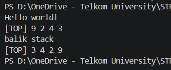
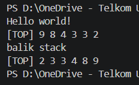
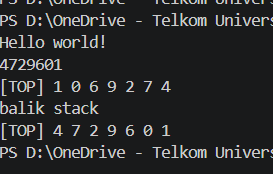

# <h1 align="center">Laporan Praktikum Modul 7 - STACK</h1>
<p align="center">Ghaly Firasah Pasha - 109082500147</p>

## Dasar Teori
Stack atau tumpukan adalah salah satu bentuk struktur data linier yang menerapkan prinsip operasi *Last In First Out* (LIFO), di mana elemen yang terakhir kali dimasukkan ke dalam tumpukan merupakan elemen pertama yang akan diambil atau dikeluarkan [[1]](http://repository.uinsu.ac.id/9717/2/Diktat%20Struktur%20Data.pdf). Berbeda dengan senarai berantai biasa yang mengizinkan penyisipan maupun penghapusan data pada sembarang posisi, seluruh akses penambahan dan pengambilan elemen pada *stack* dibatasi hanya pada satu ujung bagian atas yang disebut dengan `Top` (puncak tumpukan) [[2]](https://press.umsida.ac.id/index.php/umsidapress/article/view/978-623-6833-67-4). Dalam bahasa pemrograman C++, *Abstract Data Type* (ADT) *Stack* dapat diimplementasikan melalui dua pendekatan representasi fisik, yaitu representasi dinamis menggunakan *pointer* (*Singly Linked List*) dan representasi statis menggunakan tabel atau larik (*array*) berindeks [[3]](https://jurnal.stkippersada.ac.id/jurnal/index.php/jutech/article/view/4263). Sebagaimana standar modularisasi ADT, deklarasi struktur data beserta prototipe fungsi disimpan di dalam file *header* (`*.h`), sedangkan realisasi algoritmanya ditempatkan pada file implementasi (`*.c` atau `*.cpp`) [[2]](https://press.umsida.ac.id/index.php/umsidapress/article/view/978-623-6833-67-4).

### A. Konsep Dasar dan Representasi Struktur Data *Stack* (*Pointer* dan Tabel)<br/>
Pemilihan representasi fisik pada struktur data *stack* menentukan cara pengelolaan memori serta karakteristik batasan kapasitas tumpukan selama program dijalankan [[3]](https://jurnal.stkippersada.ac.id/jurnal/index.php/jutech/article/view/4263).

#### 1. Prinsip *Last In First Out* (LIFO) dan Penunjuk Puncak (`Top`)
Prinsip *Last In First Out* (LIFO) pada *stack* menganalogikan penyimpanan data seperti tumpukan benda fisik, di mana data baru selalu diletakkan di bagian paling atas dan menutupi elemen-elemen yang masuk sebelumnya [[1]](http://repository.uinsu.ac.id/9717/2/Diktat%20Struktur%20Data.pdf). Oleh karena itu, komponen utama yang mengendalikan seluruh aktivitas di dalam *stack* hanyalah variabel penunjuk puncak yang bernama `Top` [[4]](https://journal.piksi.ac.id/index.php/INFOKOM/article/view/160). Apabila sebuah *stack* baru diinisialisasi melalui prosedur `createStack(S)`, variabel `Top` akan diatur ke nilai kosong (`Nil` pada representasi *pointer* atau indeks awal `0` / `-1` pada representasi tabel) yang menandakan bahwa tumpukan belum memiliki elemen dan fungsi pengecekan `isEmpty(S)` akan mengembalikan nilai `true` [[5]](https://repository.universitaspahlawan.ac.id/1887/1/%282024%29%20Musridho%20-%20Diktat%20Struktur%20Data.pdf).

#### 2. Representasi *Stack* Menggunakan *Pointer* (*Linked List*)
Pada representasi fisik berbasis *pointer*, komponen penyusun *stack* pada dasarnya identik dengan komponen pada *Singly Linked List*, di mana setiap simpul (`elmStack`) memiliki medan informasi (`info`) bertipe `infotype` dan penunjuk ke simpul berikutnya (`next`) bertipe `address` [[3]](https://jurnal.stkippersada.ac.id/jurnal/index.php/jutech/article/view/4263). Struktur `stack` itu sendiri cukup menyimpan satu atribut penunjuk `address Top` yang mengacu pada simpul paling awal (paling atas), sementara simpul paling dasar di dalam tumpukan menunjuk ke `Nil` (`NULL`). Keunggulan utama dari representasi *pointer* adalah sifat alokasi memorinya yang dinamis melalui fungsi `alokasi(X)` dan `dealokasi(P)`, sehingga ukuran tumpukan dapat tumbuh dan menyusut secara fleksibel mengikuti ketersediaan memori sistem tanpa dibatasi jumlah elemen maksimum sejak awal [[4]](https://journal.piksi.ac.id/index.php/INFOKOM/article/view/160).

#### 3. Representasi *Stack* Menggunakan Tabel (*Array*)
Pada representasi tabel, struktur data `Stack` dideklarasikan menggunakan larik berindeks (`info[Imax]`) dengan kapasitas maksimum tertentu serta sebuah variabel bertipe integer bernama `Top` yang menyimpan indeks elemen teratas saat ini [[1]](http://repository.uinsu.ac.id/9717/2/Diktat%20Struktur%20Data.pdf). Berbeda dengan representasi *pointer*, representasi tabel tidak memerlukan operasi manajemen memori dinamis (`alokasi` dan `dealokasi`) karena ruang penyimpanan array telah dipesan secara kontigu sejak deklarasi variabel [[3]](https://jurnal.stkippersada.ac.id/jurnal/index.php/jutech/article/view/4263). Namun, keterbatasan kapasitas statis pada array mengharuskan program memeriksa kondisi penuh (*stack overflow*) ketika indeks `Top` telah mencapai batas maksimum (`Imax`), serta kondisi kosong (*stack underflow*) ketika `Top` berada pada posisi dasar sebelum melakukan pengambilan data [[5]](https://repository.universitaspahlawan.ac.id/1887/1/%282024%29%20Musridho%20-%20Diktat%20Struktur%20Data.pdf).

### B. Operasi-Operasi Primitif dan Manipulasi Data pada ADT *Stack*<br/>
Seluruh manipulasi data di dalam ADT *Stack* berpusat pada dua operasi primitif utama di posisi `Top` serta sejumlah prosedur pendukung untuk penelusuran dan pengolahan urutan tumpukan [[2]](https://press.umsida.ac.id/index.php/umsidapress/article/view/978-623-6833-67-4).

#### 1. Operasi Penyisipan Elemen (*Push*)
*Push* merupakan operasi dasar untuk menambahkan elemen baru ke puncak tumpukan (`Top`) [[1]](http://repository.uinsu.ac.id/9717/2/Diktat%20Struktur%20Data.pdf):
* **Pada Representasi *Pointer***: Mekanisme `push(S, P)` bekerja persis seperti operasi `insertFirst` pada *Singly Linked List*, yaitu menyiapkan simpul baru melalui `P = alokasi(X)`, menyambungkan `P->next = S.Top`, lalu memperbarui penunjuk puncak menjadi `S.Top = P` [[3]](https://jurnal.stkippersada.ac.id/jurnal/index.php/jutech/article/view/4263).
* **Pada Representasi Tabel (*Array*)**: Operasi `push(S, X)` dilakukan selama tumpukan belum penuh dengan cara menaikkan posisi indeks puncak terlebih dahulu (`S.top = S.top + 1`), kemudian menyimpan nilai data `X` ke dalam elemen larik pada indeks tersebut (`S.info[S.top] = X`) [[5]](https://repository.universitaspahlawan.ac.id/1887/1/%282024%29%20Musridho%20-%20Diktat%20Struktur%20Data.pdf).

#### 2. Operasi Pengambilan Elemen (*Pop*)
*Pop* merupakan operasi dasar untuk mengambil sekaligus mengeluarkan elemen yang berada di posisi paling atas (`Top`) dari sebuah *stack* yang tidak kosong [[4]](https://journal.piksi.ac.id/index.php/INFOKOM/article/view/160):
* **Pada Representasi *Pointer***: Mekanisme `pop(S, P)` bekerja menyerupai operasi `deleteFirst` pada senarai linier, yakni mengamankan alamat elemen puncak pada variabel `P = S.Top`, memindahkan penunjuk puncak ke simpul di bawahnya (`S.Top = (S.Top)->next`), serta memutus kaitan simpul yang diambil [[3]](https://jurnal.stkippersada.ac.id/jurnal/index.php/jutech/article/view/4263).
* **Pada Representasi Tabel (*Array*)**: Operasi `pop(S)` mengambil nilai data yang tersimpan pada indeks puncak (`temp = S.info[S.top]`), lalu menurunkan posisi indeks puncak satu tingkat ke bawah (`S.top = S.top - 1`) tanpa harus menghapus nilai fisik pada memori larik lama [[1]](http://repository.uinsu.ac.id/9717/2/Diktat%20Struktur%20Data.pdf).

#### 3. Operasi Penelusuran, Pembalikan, dan Pengolahan Masukan (`printInfo`, `balikStack`, `pushAscending`, & `getInputStream`)
Selain operasi dasar `push` dan `pop`, implementasi ADT *Stack* juga dilengkapi dengan berbagai prosedur pengolahan tumpukan [[5]](https://repository.universitaspahlawan.ac.id/1887/1/%282024%29%20Musridho%20-%20Diktat%20Struktur%20Data.pdf):
* **Penelusuran dan Pembalikan Tumpukan (`printInfo` & `balikStack`)**: Prosedur `printInfo(S)` menampilkan seluruh elemen mulai dari indeks `Top` hingga dasar tumpukan, sedangkan prosedur `balikStack(S)` membalik urutan elemen di dalam *stack* dengan memindahkan elemen satu per satu melalui operasi `pop` dan `push` ke dalam *stack* bantuan sementara.
* **Penyisipan Terurut (`pushAscending`)**: Prosedur `pushAscending(S, x)` menyisipkan elemen `x` sedemikian rupa sehingga urutan nilai di dalam tumpukan tetap terurut secara menaik (*ascending*), yakni dengan memindahkan sementara elemen-elemen puncak yang lebih besar ke *stack* bantuan sebelum menyisipkan `x` dan mengembalikan elemen-elemen tersebut kembali ke *stack* utama [[2]](https://press.umsida.ac.id/index.php/umsidapress/article/view/978-623-6833-67-4).
* **Pembacaan Aliran Karakter (`getInputStream`)**: Prosedur `getInputStream(S)` memanfaatkan fungsi pembacaan karakter seperti `cin.get()` di dalam perulangan untuk menangkap setiap karakter masukan pengguna secara berurutan hingga tombol *Enter* (`'\n'`) ditekan, mengonversi karakter digit menjadi integer, dan memasukkannya satu per satu ke dalam *stack* melalui operasi `push`.

## Guided 

### 1. Stack

```C++
//header
#ifndef STACK_H_INCLUDED
#define STACK_H_INCLUDED

struct infotype {
    char nim[20];
    char nama[20];
};

struct Stack {
    infotype info[10];
    int Top;
};

int isEmpty(Stack S);

void createStack(Stack &S);

void push(Stack &S, infotype X);

void pop(Stack &S, infotype &X);

void viewStack(Stack S);

#endif 

//body
#include "stack.h"

#include <iostream>
using namespace std;

int isEmpty(Stack S) {
    if (S.Top == 0) {
        return 0;
    } else {
        return 1;
    }
}

void createStack(Stack &S) {
    S.Top = 0;
}

void push(Stack &S, infotype X) {
    if (S.Top < 10) {
        S.Top = S.Top + 1;
        S.info[S.Top - 1] = X;
    } else {
        cout << "Stack penuh, data tidak bisa ditambahkan" << endl;
    }
}

void pop(Stack &S, infotype &X) {
    if (isEmpty(S) != 0) {
        X = S.info[S.Top - 1];
        S.Top = S.Top - 1;
    } else {
        cout << "Stack kosong, tidak ada data yang bisa diambil" << endl;
    }
}

void viewStack(Stack S) {
    if (isEmpty(S) == 0) {
        cout << "Stack kosong" << endl;
    } else {
        cout << "Isi stack (dari TOP):" << endl;
        for (int i = S.Top; i >= 1; i--) {
            cout << i << ". " << S.info[i - 1].nim << " - " << S.info[i - 1].nama << endl;
        }
    }
    
}

//main
#include <iostream>
#include <cstring>
#include "stack.h"
using namespace std;

int main() {
    Stack S;
    infotype data, hasil;

    createStack(S);
    cout << "Stack baru dibuat, Top = " << S.Top << endl;
    viewStack(S);

    cout << endl << "--- Push 3 data ---" << endl;
    strcpy(data.nim, "10311240001");
    strcpy(data.nama, "Andi");
    push(S, data);

    strcpy(data.nim, "10311240002");
    strcpy(data.nama, "Budi");
    push(S, data);

    strcpy(data.nim, "10311240003");
    strcpy(data.nama, "Citra");
    push(S, data);
    viewStack(S);

    cout << endl << "--- Pop 1 data ---" << endl;
    pop(S, hasil);
    cout << "Data yang diambil: " << hasil.nim << " - " << hasil.nama << endl;
    viewStack(S);

    cout << endl << "--- Pop sampai kosong ---" << endl;
    pop(S, hasil);
    pop(S, hasil);
    pop(S, hasil);
    viewStack(S);

    return 0;
}
```
Program di atas mengimplementasikan Abstract Data Type (ADT) Stack dengan representasi tabel (array statis berkapasitas 10 elemen) untuk menyimpan data mahasiswa (nim dan nama) yang dipisahkan ke dalam file header (stack.h), file body implementasi, dan file program utama (main.cpp). File implementasi menyediakan fungsi pengecekan tumpukan kosong (isEmpty yang mengembalikan 0 saat S.Top == 0), prosedur inisialisasi tumpukan (createStack), penambahan elemen ke puncak tumpukan dengan menaikkan nilai Top (push), pengambilan elemen puncak dengan menurunkan nilai Top (pop), serta penampilan seluruh elemen dari posisi puncak ke dasar (viewStack). Pada fungsi main(), program menguji cara kerja stack mulai dari kondisi awal kosong, menyisipkan tiga data mahasiswa (Andi, Budi, dan Citra) menggunakan bantuan fungsi strcpy dan push, mengambil satu data teratas (Citra) sesuai prinsip LIFO menggunakan pop, hingga melakukan pengambilan berulang sampai tumpukan kosong dan menampilkan pesan peringatan saat pop dipanggil pada kondisi kosong.

## Unguided 

### 1. Buatlah ADT Stack menggunakan ARRAY sebagai berikut di dalam file “stack.h”. Buatlah implementasi ADT Stack menggunakan Array pada file “stack.cpp” dan “main.cpp”

```C++
//header
#ifndef STACK1_H
#define STACK1_H

#include <iostream>
using namespace std;

typedef int infotype;

struct Stack {
    infotype info[20];
    int top;
};

void CreateStack(Stack &S);
void createStack(Stack &S);
void push(Stack &S, infotype x);
void Push(Stack &S, infotype x);
infotype pop(Stack &S);
void printInfo(Stack S);
void balikStack(Stack &S);

#endif

//body
#include "stack1.h"

void CreateStack(Stack &S) {
    S.top = 0;
}

void createStack(Stack &S) {
    CreateStack(S);
}

void push(Stack &S, infotype x) {
    if (S.top < 19) {
        S.top = S.top + 1;
        S.info[S.top] = x;
    }
}

void Push(Stack &S, infotype x) {
    push(S, x);
}

infotype pop(Stack &S) {
    infotype x = 0;
    if (S.top > 0) {
        x = S.info[S.top];
        S.top = S.top - 1;
    }
    return x;
}

void printInfo(Stack S) {
    cout << "[TOP] ";
    for (int i = S.top; i >= 1; i--) {
        cout << S.info[i] << " ";
    }
    cout << endl;
}

void balikStack(Stack &S) {
    Stack temp;
    CreateStack(temp);
    while (S.top > 0) {
        push(temp, pop(S));
    }
    S = temp;
}

//main
#include "stack1.h"

int main()
{
    cout << "Hello world!" << endl;
    Stack S;
    createStack(S);
    Push(S, 3);
    Push(S, 4);
    Push(S, 8);
    pop(S);
    Push(S, 2);
    Push(S, 3);
    pop(S);
    Push(S, 9);
    printInfo(S);
    cout << "balik stack" << endl;
    balikStack(S);
    printInfo(S);
    return 0;
}
```
### Output Unguided 1 :

##### Output 


Program di atas mengimplementasikan Abstract Data Type (ADT) Stack menggunakan representasi tabel (array statis berukuran 20 elemen bertipe integer) yang dipisahkan ke dalam tiga file, yaitu stack1.h sebagai header, stack1.cpp sebagai body implementasi, dan main.cpp sebagai program utama. File implementasi menyediakan operasi dasar inisialisasi tumpukan kosong (CreateStack dengan S.top = 0), penambahan elemen di puncak tumpukan (push), pengambilan elemen puncak (pop), penampilan isi tumpukan dari posisi TOP (printInfo), serta pembalikan urutan elemen menggunakan stack bantuan sementara (balikStack). Pada fungsi main(), serangkaian operasi Push dan pop dieksekusi secara berurutan hingga menyisakan urutan tumpukan [TOP] 9 2 4 3, yang kemudian dibalik melalui prosedur balikStack(S) sehingga menghasilkan keluaran akhir [TOP] 3 4 2 9.

### 2. Tambahkan prosedur pushAscending( in/out S : Stack, in x : integer)

```C++
//header
#ifndef STACK2_H
#define STACK2_H

#include <iostream>
using namespace std;

typedef int infotype;

struct Stack {
    infotype info[20];
    int top;
};

void CreateStack(Stack &S);
void createStack(Stack &S);
void push(Stack &S, infotype x);
void Push(Stack &S, infotype x);
infotype pop(Stack &S);
void printInfo(Stack S);
void balikStack(Stack &S);
void pushAscending(Stack &S, infotype x);

#endif

//body
#include "stack2.h"

void CreateStack(Stack &S) {
    S.top = 0;
}

void createStack(Stack &S) {
    CreateStack(S);
}

void push(Stack &S, infotype x) {
    if (S.top < 19) {
        S.top = S.top + 1;
        S.info[S.top] = x;
    }
}

void Push(Stack &S, infotype x) {
    push(S, x);
}

infotype pop(Stack &S) {
    infotype x = 0;
    if (S.top > 0) {
        x = S.info[S.top];
        S.top = S.top - 1;
    }
    return x;
}

void printInfo(Stack S) {
    cout << "[TOP] ";
    for (int i = S.top; i >= 1; i--) {
        cout << S.info[i] << " ";
    }
    cout << endl;
}

void balikStack(Stack &S) {
    Stack temp;
    CreateStack(temp);
    while (S.top > 0) {
        push(temp, pop(S));
    }
    S = temp;
}

void pushAscending(Stack &S, infotype x) {
    Stack temp;
    CreateStack(temp);
    while (S.top > 0 && S.info[S.top] > x) {
        push(temp, pop(S));
    }
    push(S, x);
    while (temp.top > 0) {
        push(S, pop(temp));
    }
}

//main
#include "stack2.h"

int main()
{
    cout << "Hello world!" << endl;
    Stack S;
    createStack(S);
    pushAscending(S, 3);
    pushAscending(S, 4);
    pushAscending(S, 8);
    pushAscending(S, 2);
    pushAscending(S, 3);
    pushAscending(S, 9);
    printInfo(S);
    cout << "balik stack" << endl;
    balikStack(S);
    printInfo(S);
    return 0;
}
```
### Output Unguided 2 :

##### Output 


Program di atas mengembangkan ADT Stack representasi tabel dengan menambahkan prosedur penyisipan terurut pushAscending yang dipisahkan ke dalam file stack2.h, stack2.cpp, dan main.cpp. Prosedur pushAscending(Stack &S, infotype x) bekerja dengan memindahkan sementara elemen-elemen puncak yang nilainya lebih besar dari x ke dalam stack bantuan temp menggunakan operasi pop dan push, menyisipkan nilai x pada posisi yang tepat, lalu mengembalikan seluruh elemen dari temp kembali ke stack utama S. Pada fungsi main(), keenam nilai (3, 4, 8, 2, 3, 9) yang dimasukkan melalui pushAscending otomatis tersusun secara terurut menjadi [TOP] 9 8 4 3 3 2, dan setelah dibalik menggunakan balikStack(S) menghasilkan keluaran [TOP] 2 3 3 4 8 9.

### 3. Tambahkan prosedur getInputStream( in/out S : Stack ). Prosedur akan terus membaca dan menerima input user dan memasukkan setiap input ke dalam stack hingga user menekan tombol enter. Contoh: gunakan cin.get() untuk mendapatkan inputan user.

```C++
//header
#ifndef STACK3_H
#define STACK3_H

#include <iostream>
using namespace std;

typedef int infotype;

struct Stack {
    infotype info[20];
    int top;
};

void CreateStack(Stack &S);
void createStack(Stack &S);
void push(Stack &S, infotype x);
void Push(Stack &S, infotype x);
infotype pop(Stack &S);
void printInfo(Stack S);
void balikStack(Stack &S);
void pushAscending(Stack &S, infotype x);
void getInputStream(Stack &S);

#endif

//body
#include "stack3.h"

void CreateStack(Stack &S) {
    S.top = 0;
}

void createStack(Stack &S) {
    CreateStack(S);
}

void push(Stack &S, infotype x) {
    if (S.top < 19) {
        S.top = S.top + 1;
        S.info[S.top] = x;
    }
}

void Push(Stack &S, infotype x) {
    push(S, x);
}

infotype pop(Stack &S) {
    infotype x = 0;
    if (S.top > 0) {
        x = S.info[S.top];
        S.top = S.top - 1;
    }
    return x;
}

void printInfo(Stack S) {
    cout << "[TOP] ";
    for (int i = S.top; i >= 1; i--) {
        cout << S.info[i] << " ";
    }
    cout << endl;
}

void balikStack(Stack &S) {
    Stack temp;
    CreateStack(temp);
    while (S.top > 0) {
        push(temp, pop(S));
    }
    S = temp;
}

void pushAscending(Stack &S, infotype x) {
    Stack temp;
    CreateStack(temp);
    while (S.top > 0 && S.info[S.top] > x) {
        push(temp, pop(S));
    }
    push(S, x);
    while (temp.top > 0) {
        push(S, pop(temp));
    }
}

void getInputStream(Stack &S) {
    char c = cin.get();
    while (c != '\n' && c != EOF) {
        if (c >= '0' && c <= '9') {
            push(S, c - '0');
        }
        c = cin.get();
    }
}

//main
#include "stack3.h"

int main()
{
    cout << "Hello world!" << endl;
    Stack S;
    createStack(S);
    getInputStream(S);
    printInfo(S);
    cout << "balik stack" << endl;
    balikStack(S);
    printInfo(S);
    return 0;
}
```
### Output Unguided 3 :

##### Output 


Program di atas menambahkan prosedur pembacaan aliran karakter getInputStream pada ADT Stack yang dipisahkan ke dalam tiga file, yaitu stack3.h, stack3.cpp, dan main.cpp. Prosedur getInputStream(Stack &S) menggunakan fungsi cin.get() di dalam perulangan while untuk membaca setiap karakter input pengguna secara berurutan hingga tombol Enter ('\n') ditekan, mengonversi setiap karakter angka menjadi nilai integer (c - '0'), lalu memasukkannya satu per satu ke dalam stack melalui prosedur push. Pada fungsi main(), ketika pengguna memasukkan deretan angka 4729601, program menampilkan isi stack sesuai prinsip LIFO yaitu [TOP] 1 0 6 9 2 7 4, kemudian membalik urutannya dengan balikStack(S) sehingga menghasilkan keluaran [TOP] 4 7 2 9 6 0 1.

## Kesimpulan
Berdasarkan praktikum Modul 7 mengenai Stack, dapat disimpulkan bahwa stack (tumpukan) merupakan struktur data linier yang beroperasi dengan prinsip Last In First Out (LIFO), di mana penambahan maupun pengambilan elemen hanya dapat dilakukan melalui satu ujung puncak yang ditandai oleh penunjuk Top. Implementasi Abstract Data Type (ADT) Stack menggunakan representasi tabel (array) dilakukan secara terstruktur dengan memisahkan deklarasi tipe data serta prototipe fungsi pada file header (*.h), realisasi algoritma pada file body (*.cpp), dan pengujian program pada file main.cpp. Dua operasi primitif utama pada stack, yaitu push untuk menyisipkan data dengan menaikkan indeks Top dan pop untuk mengambil data teratas dengan menurunkan indeks Top, wajib disertai pengecekan kapasitas maksimum dan kondisi kosong (isEmpty) agar terhindar dari stack overflow maupun stack underflow. Selain operasi dasar untuk mengelola rekod maupun nilai bertipe integer, kombinasi operasi push dan pop dengan stack bantuan terbukti efektif untuk menyelesaikan berbagai manipulasi tumpukan lanjutan, seperti membalik urutan elemen (balikStack), menyisipkan data secara terurut (pushAscending), serta mengolah aliran karakter masukan secara langsung (getInputStream).

## Referensi
[1] Triase. (2020). Diktat Edisi Revisi : [STRUKTUR DATA](http://repository.uinsu.ac.id/9717/2/Diktat%20Struktur%20Data.pdf). Medan: UNIVERSITAS ISLAM NEGERI SUMATERA UTARA MEDAN.
<br>[2] Indahyati, Uce., Rahmawati Yunianita. (2020). "[BUKU AJAR ALGORITMA DAN PEMROGRAMAN DALAM BAHASA C++](https://press.umsida.ac.id/index.php/umsidapress/article/view/978-623-6833-67-4)". Sidoarjo: Umsida Press. Diakses pada 10 Maret 2024 melalui https://doi.org/10.21070/2020/978-623-6833-67-4.
<br>[3] Pratama, A., dkk. (2024). "[Penggunaan Struktur Data Stack dalam Pemrograman C++ dengan Pendekatan Array dan Linked List](https://jurnal.stkippersada.ac.id/jurnal/index.php/jutech/article/view/4263)". *Jurnal Pendidikan Teknologi Informasi (JUTECH)*, 5(2), 484–499. Diakses melalui https://jurnal.stkippersada.ac.id/jurnal/index.php/jutech/article/view/4263.
<br>[4] Rosadi, D., dkk. (2020). "[Penerapan Stack dan Queue pada Array dan Linked List dalam Java](https://journal.piksi.ac.id/index.php/INFOKOM/article/view/160)". *Jurnal Infokom (Informatika & Komputer)*, 8(1), 18–24. Diakses melalui https://journal.piksi.ac.id/index.php/INFOKOM/article/view/160.
<br>[5] Musridho, R. (2024). "[Diktat Struktur Data](https://repository.universitaspahlawan.ac.id/1887/1/%282024%29%20Musridho%20-%20Diktat%20Struktur%20Data.pdf)". Bangkinang: Universitas Pahlawan Tuanku Tambusai. Diakses melalui https://repository.universitaspahlawan.ac.id/1887/1/%282024%29%20Musridho%20-%20Diktat%20Struktur%20Data.pdf.
